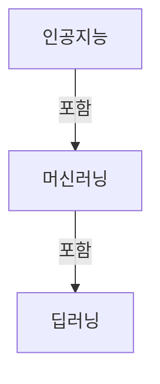
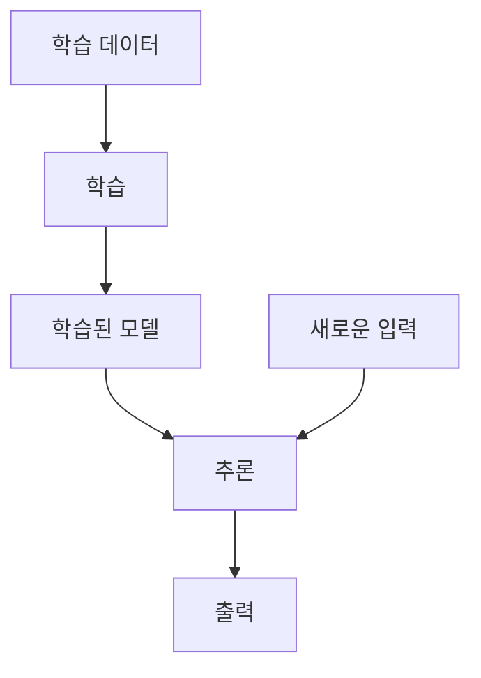

**인공지능을 직접 개발하지 않더라도, 어떤 기술이고 어떻게 동작하며 어디까지 믿을 수 있는지 이해하는 것은 중요합니다.** 이 글은 모델 구현이나 수식보다 전체 구조와 용어 사이의 관계에 초점을 맞춥니다.

머신러닝과 딥러닝은 기술의 관계를, 학습과 추론은 모델을 만들고 사용하는 과정을 설명합니다. 여기에 생성형 AI와 외부 정보 연결 방식을 구분하면 AI 기능을 가진 소프트웨어의 구조도 이해할 수 있습니다.

## 1. 인공지능·머신러닝·딥러닝의 관계

**인공지능(AI, Artificial Intelligence)**은 인식·학습·추론·의사결정 같은 지적 기능을 컴퓨터로 구현하는 기술과 연구 분야입니다. 데이터를 학습하는 방법뿐 아니라, 사람이 명시한 지식과 규칙을 사용하는 접근도 포함합니다.

**머신러닝(ML, Machine Learning)**은 데이터에서 패턴을 학습하여 새로운 입력에 대한 출력을 결정하는 방법입니다. 사람이 모든 판단 규칙을 직접 작성하는 대신, 데이터와 학습 목표를 바탕으로 모델을 구성합니다.

**딥러닝(DL, Deep Learning)**은 여러 층으로 구성된 신경망을 사용하는 머신러닝의 한 분야입니다. 층을 거치며 입력의 표현을 변환하고, 작업에 필요한 특징을 학습합니다.

이 그림은 포함 관계를 나타냅니다. 모든 인공지능이 머신러닝인 것은 아니며, 모든 머신러닝이 딥러닝인 것도 아닙니다. [IBM: 인공지능과 관련 기술의 관계](https://www.ibm.com/think/topics/artificial-intelligence)

## 2. 모델·데이터·파라미터

**모델(Model)**은 입력을 받아 출력을 계산하는 구조입니다. 머신러닝에서는 학습을 통해 데이터의 관계가 이 구조에 반영됩니다.

| 용어 | 의미 |
| --- | --- |
| 데이터(Data) | 학습과 평가에 사용하는 정보 |
| 특징(Feature) | 모델이 입력으로 사용하거나 내부에서 추출하는 정보의 속성 |
| 레이블(Label) | 지도학습에서 목표 출력으로 제공하는 값 |
| 파라미터(Parameter) | 학습 과정에서 조정되는 모델 내부 값 |
| 하이퍼파라미터(Hyperparameter) | 학습 방식이나 모델 구성을 제어하는 설정값 |

모델의 동작은 구조와 파라미터에 의해 결정됩니다. 같은 구조라도 학습 데이터와 학습 과정이 다르면 다른 결과를 낼 수 있습니다. 파라미터 수는 모델 규모를 설명하지만, 그 수만으로 성능을 판단할 수는 없습니다. [Google: 머신러닝 용어집](https://developers.google.com/machine-learning/glossary)

## 3. 학습과 추론

**학습(Training)**은 데이터와 학습 목표를 바탕으로 모델을 조정하는 과정입니다. **추론(Inference)**은 학습된 모델에 입력을 넣어 출력을 계산하는 과정입니다.

| 구분 | 학습 | 추론 |
| --- | --- | --- |
| 목적 | 모델의 동작 조정 | 모델을 사용해 결과 계산 |
| 파라미터 | 학습 방식에 따라 갱신 | 일반적으로 고정 |
| 결과 | 학습된 모델 | 입력에 대한 출력 |

**모델을 사용한다고 해서 매번 모델이 다시 학습되는 것은 아닙니다.** 추론 중 입력 정보가 결과에 영향을 주는 것과 파라미터가 갱신되는 것은 구분됩니다. 학습과 추론을 결합한 시스템도 있지만, 두 과정의 역할은 다릅니다. [IBM: AI 추론](https://www.ibm.com/think/topics/ai-inference)

## 4. 학습 방식의 구분

학습 방식은 모델이 어떤 신호를 바탕으로 개선되는지에 따라 구분할 수 있습니다.

| 방식 | 학습 신호 | 핵심 목적 |
| --- | --- | --- |
| 지도학습 | 입력과 함께 제공된 목표 출력 | 입력과 출력의 관계 학습 |
| 비지도학습 | 명시적인 목표 레이블이 없는 데이터 | 데이터의 구조와 패턴 발견 |
| 자기지도학습 | 데이터 자체에서 구성한 목표 | 데이터의 표현과 관계 학습 |
| 강화학습 | 환경과 상호작용하며 얻는 보상 | 누적 보상을 높이는 행동 정책 학습 |

자기지도학습은 사람이 정답을 일일이 붙이지 않아도 학습 목표를 구성할 수 있다는 점이 중요합니다. 강화학습에서 **정책(Policy)**은 주어진 상태에서 행동을 결정하는 방식입니다. [Google: 머신러닝 용어집](https://developers.google.com/machine-learning/glossary)

이 분류는 딥러닝과 다른 기준입니다. 딥러닝은 모델 구조에 관한 개념이므로 여러 학습 방식과 결합할 수 있습니다. 지도학습의 대표적인 작업 유형인 **분류**는 범주를, **회귀**는 수치를 예측합니다. [Google: 머신러닝 개요](https://developers.google.com/machine-learning/intro-to-ml/what-is-ml)

## 5. 신경망이 학습하는 구조

**신경망(Neural Network)**은 계산 단위들을 층으로 연결한 모델입니다. 각 층은 입력을 변환하고 다음 층으로 전달합니다.

| 구성 요소 | 역할 |
| --- | --- |
| 입력층 | 입력 데이터 수용 |
| 은닉층 | 내부 표현과 특징 변환 |
| 출력층 | 작업에 필요한 결과 계산 |
| 가중치·편향 | 학습으로 조정되는 내부 파라미터 |
| 활성화 함수 | 비선형 변환을 통해 복잡한 관계 표현 |

딥러닝은 여러 층의 변환을 통해 복잡한 관계를 학습합니다. 신경망이라는 이름은 생물학적 신경계에서 영감을 받았지만, 모델의 동작은 수학적 연산으로 이루어집니다. [Google: 신경망](https://developers.google.com/machine-learning/crash-course/neural-networks)

신경망 학습에서는 **손실 함수(Loss Function)**로 학습 목표에 비추어 출력이 얼마나 부적절한지 수치화합니다. **역전파(Backpropagation)**는 손실이 각 파라미터에 따라 어떻게 변하는지 계산하고, **최적화 알고리즘(Optimizer)**은 이 정보를 이용해 파라미터를 갱신합니다.

즉, 출력을 계산하는 과정과 그 결과를 바탕으로 파라미터를 조정하는 과정이 반복됩니다. [Google: 역전파를 이용한 학습](https://developers.google.com/machine-learning/crash-course/neural-networks/backpropagation)

## 6. 일반화와 과적합

**일반화(Generalization)**는 학습에 사용하지 않은 데이터에서도 적절한 결과를 내는 능력입니다. 학습 데이터에서의 성능만으로 모델의 실질적인 성능을 판단하기 어려운 이유입니다.

**과적합(Overfitting)**은 학습 데이터의 특성에 지나치게 맞춰져 새로운 데이터에서는 성능이 떨어지는 상태입니다. **과소적합(Underfitting)**은 필요한 관계를 충분히 학습하지 못해 학습 데이터에서도 성능이 부족한 상태입니다. [Google: 과적합](https://developers.google.com/machine-learning/crash-course/overfitting/overfitting), [Google: 머신러닝 용어집](https://developers.google.com/machine-learning/glossary)

| 데이터 구분 | 역할 |
| --- | --- |
| 학습 데이터 | 모델 파라미터 조정 |
| 검증 데이터 | 모델 선택과 학습 설정 조정에 필요한 평가 |
| 테스트 데이터 | 선택된 모델의 최종 성능 평가 |

이 구분은 모델이 이미 접한 정보에 대한 성능과 새로운 정보에 대한 성능을 분리하기 위한 것입니다. 테스트 결과를 반복적으로 보며 모델을 수정하면 테스트 데이터도 선택 과정에 영향을 주게 됩니다.

평가 데이터와 실제 사용 환경의 데이터가 크게 다르면 평가 결과를 그대로 기대하기 어렵습니다. **데이터의 양뿐 아니라 품질과 대표성도 성능을 좌우합니다.** [Google: 학습·검증·테스트 데이터 분리](https://developers.google.com/machine-learning/crash-course/overfitting/dividing-datasets)

## 7. 생성형 AI와 대규모 언어 모델

**생성형 AI(Generative AI)**는 학습한 데이터의 패턴을 바탕으로 콘텐츠를 생성하는 기술입니다. 생성형이라는 말은 결과의 성격을 설명하며, 딥러닝이라는 모델 구조의 분류와는 기준이 다릅니다. 현대의 생성형 AI는 주로 딥러닝을 기반으로 합니다. [IBM: 인공지능과 생성형 AI](https://www.ibm.com/think/topics/artificial-intelligence)

**대규모 언어 모델(LLM, Large Language Model)**은 많은 언어 데이터와 큰 모델 규모를 바탕으로 언어의 패턴과 관계를 학습한 모델입니다. 텍스트를 생성하는 자기회귀 언어 모델은 주어진 문맥에 이어질 토큰의 확률을 계산하고, 토큰을 순차적으로 생성합니다.

| 용어 | 의미 |
| --- | --- |
| 토큰(Token) | 모델이 텍스트를 처리하는 단위 |
| 문맥(Context) | 현재 출력 계산에 사용되는 입력 정보 |
| 프롬프트(Prompt) | 모델에 제공하는 지시와 입력 내용 |

토큰은 단어와 반드시 일치하지 않습니다. 또한 문맥을 제공하여 출력을 바꾸는 것과 모델을 추가로 학습시키는 것은 서로 다른 과정입니다. [Google: 언어 모델 개요](https://developers.google.com/machine-learning/crash-course/llm)

## 8. 프롬프트·파인튜닝·RAG의 차이

AI의 결과를 바꾸는 방법은 모두 재학습을 의미하지 않습니다. **입력 정보를 바꾸는 것, 모델을 추가로 학습시키는 것, 외부 자료를 찾아 제공하는 것**은 다른 방식입니다.

| 개념 | 바꾸는 대상 | 역할 |
| --- | --- | --- |
| 프롬프트 | 추론 시 제공하는 지시와 문맥 | 현재 요청의 목적과 조건 전달 |
| 파인튜닝(Fine-tuning) | 모델의 학습 가능한 파라미터 | 추가 학습으로 특정 작업에 맞게 조정 |
| RAG | 검색을 통해 제공하는 문맥 | 외부 자료를 근거로 생성하도록 지원 |

파인튜닝은 이미 학습된 모델을 추가로 학습하는 과정입니다. 프롬프트를 수정하는 것은 일반적으로 모델 파라미터를 바꾸지 않습니다. [Google: 파인튜닝과 프롬프트](https://developers.google.com/machine-learning/crash-course/llm/tuning)

**RAG(Retrieval-Augmented Generation, 검색 증강 생성)**는 관련 자료를 검색하여 모델의 입력에 함께 제공하는 구조입니다. 최신 정보나 별도 문서를 활용할 수 있지만, 검색된 자료의 품질과 모델의 해석에 따라 결과가 달라집니다. RAG 자체가 모델의 재학습을 뜻하지는 않습니다. [Google Cloud: RAG](https://cloud.google.com/use-cases/retrieval-augmented-generation)

## 9. AI 모델과 AI 서비스의 차이

**모델은 출력을 계산하는 구성 요소이고, 서비스는 모델에 검색·저장·화면·도구 등의 기능을 결합한 전체 시스템입니다.** 따라서 서비스가 외부 정보를 찾는다고 해서 모델 자체가 모든 최신 정보를 학습하고 있는 것은 아닙니다. 검색 기능이 별도로 문맥을 제공할 수 있습니다. [Google Cloud: 검색과 생성을 결합한 구조](https://cloud.google.com/use-cases/retrieval-augmented-generation)

생성형 AI는 자연스러운 문장을 만들면서도 사실과 다른 내용을 제시할 수 있습니다. 이를 **환각(Hallucination)**이라고 부릅니다. 학습 데이터의 편향도 결과에 영향을 줄 수 있습니다. **문장이 자연스럽다는 것과 내용이 정확하다는 것은 별개의 문제**입니다. [Google: 대규모 언어 모델의 한계](https://developers.google.com/machine-learning/crash-course/llm/transformers)

## 10. 개념 사이의 관계

| 구분하는 대상 | 관련 개념 |
| --- | --- |
| 기술의 범위 | 인공지능 → 머신러닝 → 딥러닝 |
| 계산 구조 | 모델·신경망·파라미터 |
| 개선에 사용하는 신호 | 지도·비지도·자기지도·강화학습 |
| 모델을 만들고 사용하는 과정 | 학습·추론 |
| 새로운 데이터에 대한 성능 | 일반화·과적합 |
| 출력과 처리 대상의 성격 | 생성형 AI·언어 모델 |
| AI 결과를 조정하는 방식 | 프롬프트·파인튜닝·RAG |
| 소프트웨어의 구성 범위 | 모델·서비스 |

이 용어들은 모두 같은 기준으로 나눈 기술 목록이 아닙니다. **어떤 구조를 사용하고, 무엇을 바탕으로 학습하며, 어떤 결과를 만드는지**를 각각 설명합니다.

활용 관점의 프롬프트·도구·스킬은 [AI 활용 핵심 개념](/posts/ai-usage-core-concepts/), MCP·에이전트·RAG의 연결 구조는 [AI 활용 심화 개념](/posts/ai-usage-advanced-concepts/)에서 이어집니다.
