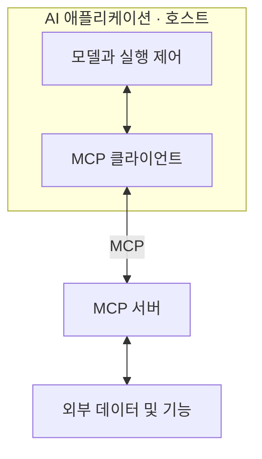
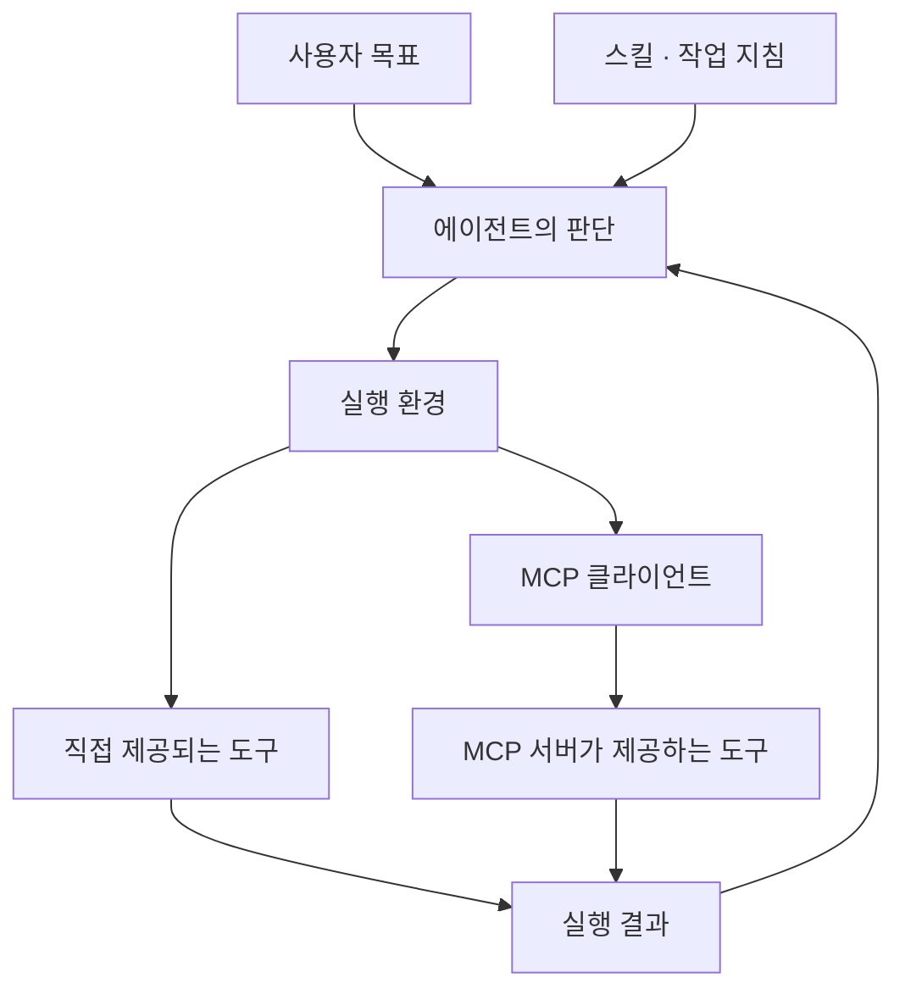

**AI 기능이 확장되는 과정은 모델 하나가 모든 기능을 갖게 되는 것이 아니라, 모델에 지침·정보·도구·실행 흐름을 결합하는 과정입니다.** MCP, 스킬, RAG, 에이전트는 이 구조에서 서로 다른 역할을 맡습니다.

프롬프트와 문맥, 도구의 기본 의미는 [AI 활용 핵심 개념](/posts/ai-usage-core-concepts/)에 정리되어 있습니다. 여기서는 설치나 구현 절차보다 각 기능의 연결 원리를 설명합니다.

## 1. MCP의 호스트·클라이언트·서버

**MCP(Model Context Protocol)**는 AI 애플리케이션과 외부 프로그램 사이의 정보·기능 교환을 표준화합니다.

| 구성 요소 | 역할 |
| --- | --- |
| 호스트(Host) | 사용자와 모델, 연결 기능을 관리하는 AI 애플리케이션 |
| 클라이언트(Client) | 호스트 안에서 MCP 서버와 통신하는 구성 요소 |
| 서버(Server) | MCP를 통해 데이터와 기능을 제공하는 프로그램 |

MCP 서버는 로컬 컴퓨터에서도, 원격 환경에서도 실행될 수 있습니다. 서버라는 명칭이 반드시 별도의 물리적 서버를 뜻하지는 않습니다. MCP는 연결을 규정하며, 모델이 어떤 판단을 하거나 작업을 어떤 순서로 수행할지까지 결정하지 않습니다. [MCP: 아키텍처](https://modelcontextprotocol.io/docs/learn/architecture)

## 2. MCP가 제공하는 세 가지 기능

| 기능 | 의미 | 주된 사용 결정 주체 |
| --- | --- | --- |
| Tools | 호출하여 실행하는 기능 | 모델 |
| Resources | 문맥으로 사용할 데이터 | 애플리케이션 |
| Prompts | 재사용할 지시 템플릿 | 사용자 |

이는 MCP가 제시하는 기본 상호작용 구분입니다. 실제 노출 방식과 실행 허용 여부는 호스트의 구현과 정책에 따라 달라집니다.

Resources는 자료 제공에, Tools는 기능 실행에 초점이 있습니다. 다만 도구가 읽기 전용 조회를 수행할 수도 있으므로 도구와 쓰기 작업을 같은 뜻으로 보면 안 됩니다. 서버가 세 기능을 모두 제공해야 하는 것도 아닙니다. [MCP: 서버 기능](https://modelcontextprotocol.io/docs/learn/server-concepts)

## 3. 스킬은 어떻게 적용되는가

Agent Skills는 작업에 필요한 정보를 단계적으로 불러오는 방식을 사용합니다.

| 단계 | 읽는 내용 |
| --- | --- |
| 발견 | 스킬 이름과 설명 |
| 적용 | 선택한 스킬의 전체 지침 |
| 수행 | 필요한 참고 문서·스크립트·자료 |

이 방식을 **점진적 로딩(Progressive Disclosure)**이라고 부릅니다. 모든 자료를 처음부터 문맥에 넣는 대신, 해당 작업에 필요한 상세 정보를 불러오는 구조입니다.

`SKILL.md`는 중심 지침이고, 참고 자료와 스크립트는 필요에 따라 사용됩니다. 스킬을 읽었다는 사실과 포함된 스크립트를 실행했다는 사실은 다릅니다. 지원하는 기능과 실행 가능한 언어·도구는 에이전트 환경에 따라 달라집니다. [Agent Skills: 형식과 점진적 로딩](https://agentskills.io/specification)

## 4. 스킬·MCP·도구의 결합

세 요소의 관계는 **작업 방법, 연결 방식, 실행 기능**으로 나누면 분명해집니다.

이 그림은 역할을 조합한 개념도입니다. 스킬이 MCP 서버를 반드시 포함하는 것도 아니고, MCP 서버에 연결하면 작업 지침이 자동으로 만들어지는 것도 아닙니다. 스킬에서 요구하는 기능이 실제 환경에 제공되는지가 별도로 중요합니다. [Agent Skills: 구성과 환경 조건](https://agentskills.io/specification), [MCP: 아키텍처](https://modelcontextprotocol.io/docs/learn/architecture)

## 5. 에이전트와 워크플로

**워크플로(Workflow)**는 미리 정의된 흐름에 따라 모델과 도구를 실행합니다. **에이전트(Agent)**는 목표와 현재 상태를 바탕으로 다음 행동을 모델이 선택하는 구조입니다.

에이전트는 대체로 **판단 → 도구 실행 → 결과 확인 → 다음 판단**을 반복합니다. 스킬은 이 반복 과정에서 참고하는 작업 방법이고, MCP는 사용할 수 있는 외부 기능을 연결하는 수단입니다.

자동화가 반드시 에이전트를 의미하지는 않습니다. 정해진 흐름의 자동화에도 모델을 사용할 수 있습니다. 에이전트의 유연성에는 추가 호출·실행 시간·비용이 따르므로, 종료 조건과 완료 기준이 작업 구조의 일부가 됩니다. [Anthropic: 에이전트와 워크플로의 구조](https://www.anthropic.com/research/building-effective-agents)

## 6. RAG와 MCP의 차이

**RAG(Retrieval-Augmented Generation)**는 관련 정보를 검색하여 생성의 근거로 제공하는 방식입니다. 모델에 전체 자료를 다시 학습시키는 대신, 현재 요청과 관련된 내용을 입력 문맥에 추가합니다.

| 개념 | 다루는 문제 |
| --- | --- |
| RAG | 어떤 정보를 찾아 생성의 근거로 사용할지 |
| MCP | 정보와 기능을 어떤 규약으로 연결할지 |
| 스킬 | 작업을 어떤 절차와 기준으로 진행할지 |

RAG의 검색 기능을 MCP 도구로 제공할 수 있지만, MCP 없이도 RAG를 구성할 수 있습니다. 두 개념은 대체 관계가 아닙니다. 이는 검색 방식과 연결 규약을 각각 구분한 관계입니다. [Google Cloud: RAG](https://cloud.google.com/use-cases/retrieval-augmented-generation), [MCP: 아키텍처](https://modelcontextprotocol.io/docs/learn/architecture)

검색 결과에 필요한 자료가 없거나 자료 자체가 부정확하면 결과의 품질도 제한됩니다. 검색이 이루어졌다는 사실만으로 답변의 정확성이 보장되지는 않습니다. [Google Cloud: 검색 기반 생성](https://cloud.google.com/use-cases/retrieval-augmented-generation)

## 7. 문맥·메모리·상태

여러 단계의 작업에서는 지금 참고하는 정보와 나중에 다시 사용할 정보, 작업의 진행 상태를 구분해야 합니다.

| 개념 | 의미 |
| --- | --- |
| 문맥(Context) | 현재 모델 호출에 전달되는 정보 |
| 메모리(Memory) | 이후 다시 활용하도록 보존하는 정보 |
| 작업 상태(State) | 진행 단계, 중간 결과, 남은 작업에 관한 정보 |

저장된 메모리는 필요할 때 검색하거나 불러와 문맥에 포함해야 모델의 판단에 영향을 줍니다. 장기 작업에서는 중요한 결정을 보존하고, 중간 결과를 요약하며, 불필요한 정보를 줄이는 관리가 필요합니다. 요약은 원문과 완전히 같지 않으므로 세부 정보가 필요하면 원본을 다시 읽을 수 있어야 합니다. [Anthropic: 장기 작업의 문맥 관리](https://www.anthropic.com/research/effective-context-engineering-for-ai-agents)

## 8. 연결·권한·실행의 구분

MCP 연결이나 스킬 적용은 작업을 수행하기 위한 일부 조건입니다. 실제 실행에는 필요한 도구와 계정 접근, 실행 권한이 함께 충족되어야 합니다.

스킬에 기능 이름이 적혀 있다는 이유만으로 그 기능이 설치되거나 권한이 부여되는 것은 아닙니다. 도구가 제공되더라도 호스트의 정책이나 서비스 권한에 따라 실행이 제한될 수 있습니다. [Agent Skills: 환경 호환성](https://agentskills.io/specification), [MCP: 도구 실행과 사용자 제어](https://modelcontextprotocol.io/docs/learn/server-concepts)

따라서 기능의 상태를 이해할 때는 **연결 가능 여부 → 기능 제공 여부 → 실행 허용 여부 → 실행 결과**를 구분하는 것이 유용합니다. 이는 연결 성공과 작업 완료를 혼동하지 않기 위한 판단 기준입니다.

## 9. 전체 구조의 관계

프롬프트는 목표를 전달하고, 스킬은 반복할 작업 방법을 제공합니다. RAG와 메모리는 필요한 정보를 문맥에 공급하며, 도구는 실제 작업을 수행합니다. MCP는 외부 기능을 연결하고, 워크플로나 에이전트는 이 요소들의 실행 흐름을 구성합니다.

핵심은 모든 기능을 한꺼번에 사용하는 데 있지 않습니다. **부족한 것이 지시인지, 정보인지, 실행 기능인지, 작업 흐름인지 구분하는 것**이 AI 활용 구조를 이해하는 기준입니다.
