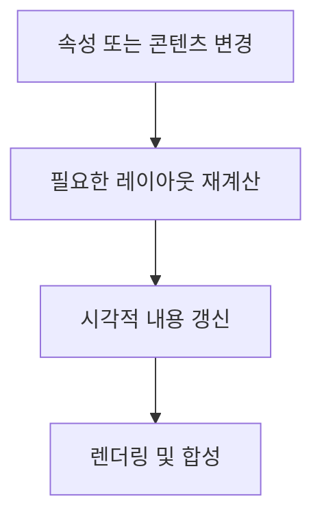

**WPF의 화면은 객체 트리, 속성 시스템, 이벤트 경로, 레이아웃과 렌더링이 함께 동작한 결과입니다.** 이 구조를 이해하면 화면에 값이 반영되는 과정과 UI의 응답성이 결정되는 이유를 연결해서 볼 수 있습니다.

화면 구성과 바인딩·MVVM의 기본 역할은 [WPF 핵심 개념](/posts/wpf-core-concepts/)에 정리되어 있습니다.

## 1. WPF 객체의 기반 구조

| 기반 형식 | 주요 책임 |
| --- | --- |
| DispatcherObject | 소유 스레드와 Dispatcher 연결 |
| DependencyObject | 의존성 속성 시스템 참여 |
| Visual | 시각적 내용과 시각 트리의 기반 |
| UIElement | 입력·이벤트·레이아웃의 기반 |
| FrameworkElement | 스타일·리소스·데이터 연결 등 프레임워크 기능 |
| Control | 템플릿을 사용하는 컨트롤의 기반 |

이 계층은 상위 기능이 하위 기반 위에 쌓이는 구조입니다. 모든 화면 요소가 `Control`인 것은 아니며, 각 형식이 제공하는 역할도 다릅니다. [Microsoft: WPF 아키텍처](https://learn.microsoft.com/en-us/dotnet/desktop/wpf/advanced/wpf-architecture)

## 2. 의존성 속성

**의존성 속성(Dependency Property)**은 WPF 속성 시스템이 값을 관리하는 속성입니다. 일반적인 CLR 속성처럼 사용할 수 있지만, 실제 값은 로컬 설정뿐 아니라 바인딩·스타일·애니메이션 등의 영향을 받아 결정될 수 있습니다.

| 구성 | 의미 |
| --- | --- |
| 속성 등록 정보 | 이름, 형식, 소유 형식 등 식별 정보 |
| 메타데이터 | 기본값, 변경 처리, 레이아웃 영향 등의 정책 |
| 유효 값 | 우선순위와 정책을 적용한 최종 값 |

**속성 값 상속**은 일부 속성이 부모 요소의 값을 이어받는 기능입니다. 모든 의존성 속성에 적용되는 것은 아닙니다.

**연결 속성(Attached Property)**은 한 형식이 정의한 속성을 다른 객체에 설정할 수 있도록 하는 개념입니다. WPF에서는 보통 의존성 속성 시스템으로 구현됩니다. [Microsoft: 의존성 속성](https://learn.microsoft.com/en-us/dotnet/desktop/wpf/properties/dependency-properties-overview)

## 3. 속성 값의 우선순위

같은 속성에 여러 값이 영향을 주면 **마지막에 작성한 값이 무조건 적용되는 방식이 아니라, 속성 시스템의 우선순위로 유효 값이 결정됩니다.**

주요 관계만 추리면 값 강제 변환(Coercion), 활성 애니메이션, 로컬 값은 스타일의 일반 설정값보다 높은 우선순위를 가집니다. 로컬 값으로 설정된 바인딩도 로컬 값의 우선순위를 가집니다.

따라서 스타일의 설정이 바뀌어도 더 높은 우선순위의 값이 유지되면 화면의 유효 값은 바뀌지 않을 수 있습니다. 템플릿·트리거·테마까지 포함한 전체 순서는 더 세분화되어 있습니다. [Microsoft: 의존성 속성 값 우선순위](https://learn.microsoft.com/en-us/dotnet/desktop/wpf/properties/dependency-property-value-precedence)

## 4. 논리 트리와 시각 트리

WPF의 객체 관계는 하나의 관점으로만 표현되지 않습니다.

| 구분 | 나타내는 관계 |
| --- | --- |
| 논리 트리(Logical Tree) | 콘텐츠와 요소의 논리적인 포함 관계 |
| 시각 트리(Visual Tree) | 실제 시각 요소와 템플릿 내부 요소의 관계 |

템플릿을 적용하면 외부에서 보이는 컨트롤 하나가 여러 내부 시각 요소로 표현될 수 있습니다. 이 때문에 논리 트리와 시각 트리는 항상 동일하지 않습니다.

리소스 탐색, 속성 상속, 이벤트 경로는 요소의 관계를 활용하지만, 모든 기능이 언제나 같은 트리를 같은 방식으로 탐색하는 것은 아닙니다. **XAML의 들여쓰기만으로 실행 중의 전체 시각 구조를 설명할 수는 없습니다.** [Microsoft: WPF의 트리](https://learn.microsoft.com/en-us/dotnet/desktop/wpf/advanced/trees-in-wpf)

## 5. 라우팅 이벤트

**라우팅 이벤트(Routed Event)**는 요소 트리의 경로를 따라 여러 요소에서 처리할 수 있는 이벤트입니다.

| 방식 | 전달 구조 |
| --- | --- |
| 버블링(Bubbling) | 발생 지점에서 상위 요소 방향 |
| 터널링(Tunneling) | 상위 요소에서 발생 지점 방향 |
| 직접(Direct) | 해당 요소에서 처리 |

이벤트의 발생 객체와 핸들러가 실행되는 객체는 다를 수 있습니다. `Handled`는 이벤트가 처리되었음을 나타내며 일반적인 후속 핸들러 호출을 억제할 수 있습니다. 다만 처리된 이벤트도 받도록 등록한 핸들러가 있으므로, **Handled가 모든 전달과 관찰을 절대적으로 차단하는 것은 아닙니다.** [Microsoft: 라우팅 이벤트](https://learn.microsoft.com/en-us/dotnet/desktop/wpf/events/routed-events-overview)

## 6. 레이아웃과 렌더링

레이아웃은 크기와 위치를 계산하고, 렌더링은 시각적 결과를 구성합니다.

| 단계 | 역할 |
| --- | --- |
| Measure | 주어진 공간에서 요소가 원하는 크기 계산 |
| Arrange | 할당된 영역 안에서 요소의 크기와 위치 결정 |
| Render | 결정된 구조를 바탕으로 시각적 내용 구성 |

부모와 자식은 레이아웃 계산에 함께 참여합니다. 속성 변경으로 레이아웃이 무효화되면 필요한 계산이 다시 예약될 수 있으며, 모든 속성 변경이 같은 비용을 발생시키는 것은 아닙니다. [Microsoft: 레이아웃 시스템](https://learn.microsoft.com/en-us/dotnet/desktop/wpf/advanced/layout)

이 그림은 레이아웃에 영향을 주는 변경의 흐름을 단순화한 것입니다. 렌더링만 갱신하면 되는 변경도 있습니다.

WPF는 시각적 정보를 유지하고 필요한 변경을 반영하는 렌더링 구조를 사용합니다. 내부 렌더링은 DirectX와 연결되며, 환경에 따라 하드웨어 또는 소프트웨어 렌더링이 사용됩니다. 따라서 모든 처리가 항상 GPU에서 수행된다고 해석해서는 안 됩니다. [Microsoft: WPF 아키텍처](https://learn.microsoft.com/en-us/dotnet/desktop/wpf/advanced/wpf-architecture)

## 7. Dispatcher와 UI 응답성

**Dispatcher는 소유 스레드에서 실행할 작업을 관리하는 대기열과 실행 체계**입니다. 작업은 우선순위에 따라 선택되고, 선택된 작업은 실행을 마칠 때까지 해당 스레드를 사용합니다.

Dispatcher에 작업을 등록하는 것은 작업을 다른 백그라운드 스레드로 옮기는 것과 다릅니다. UI Dispatcher에 긴 작업을 등록하면 그 작업도 UI 스레드의 응답성을 떨어뜨립니다.

`Invoke`는 동기 호출이고, `InvokeAsync`는 작업을 비동기적으로 예약합니다. 비동기 예약은 작업 자체의 실행 시간을 줄여주지 않습니다. UI 스레드가 필요한 작업을 동기적으로 기다리는 구조는 교착 상태를 만들 수도 있습니다.

별도의 렌더링 스레드가 있더라도 UI 상태 갱신과 레이아웃 등 UI 스레드가 담당하는 처리가 막히면 화면은 정상적으로 반응하기 어렵습니다. [Microsoft: Dispatcher와 스레딩 모델](https://learn.microsoft.com/en-us/dotnet/desktop/wpf/advanced/threading-model)

## 8. UI 가상화와 데이터 가상화

**UI 가상화**는 화면에 필요한 항목의 UI 컨테이너를 중심으로 생성하고 배치하여 비용을 줄이는 방식입니다. **데이터 가상화**는 데이터 자체를 필요한 범위만 불러오고 유지하는 방식입니다.

UI 요소를 적게 만들더라도 전체 데이터는 메모리에 남아 있을 수 있으므로 두 개념은 구분됩니다. 컨테이너 재활용은 이미 생성한 UI 컨테이너를 다시 사용하는 기능이며, 가상화의 적용 여부는 컨트롤과 패널 구성에 영향을 받습니다. [Microsoft: 컨트롤 성능과 가상화](https://learn.microsoft.com/en-us/dotnet/desktop/wpf/advanced/optimizing-performance-controls)

## 9. 구조 사이의 연결

의존성 속성은 유효 값을 결정하고, 트리는 요소의 관계를 정의합니다. 이벤트는 그 관계를 따라 전달되며, 레이아웃과 렌더링은 화면을 구성합니다. Dispatcher는 UI 스레드에서 이러한 처리와 애플리케이션 작업이 실행되는 순서를 관리합니다.

[WPF 핵심 개념](/posts/wpf-core-concepts/)의 바인딩·스타일·템플릿은 이러한 내부 기능 위에서 동작합니다.
