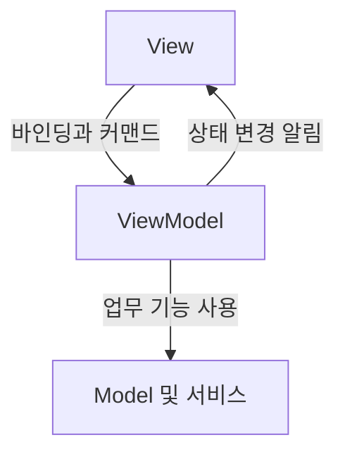

**WPF는 화면의 구조, 표시할 데이터, 사용자 동작을 연결하는 Windows 데스크톱 UI 프레임워크입니다.** 핵심은 화면 요소를 배치하는 것뿐 아니라, 데이터의 변화가 화면에 반영되는 구조를 이해하는 데 있습니다.

이 글은 각 기능의 역할을 정리합니다. 속성 시스템·이벤트·렌더링의 내부 관계는 [WPF 구조 심화](/posts/wpf-architecture/)에서 이어집니다.

## 1. WPF의 역할

**WPF(Windows Presentation Foundation)**는 .NET 기반 Windows 데스크톱 애플리케이션의 사용자 인터페이스를 구성하는 프레임워크입니다. 컨트롤, 레이아웃, 데이터 바인딩, 그래픽, 스타일과 템플릿을 제공합니다.

WPF는 벡터 기반의 렌더링과 장치 독립적인 크기 체계를 사용합니다. .NET이 여러 운영체제를 지원하더라도 WPF 자체의 실행 대상은 Windows입니다. [Microsoft: WPF 개요](https://learn.microsoft.com/en-us/dotnet/desktop/wpf/overview/)

## 2. XAML과 코드

**XAML**은 객체와 속성, 객체 사이의 포함 관계를 선언적으로 표현하는 마크업 언어입니다. WPF에서는 화면 구성과 리소스, 바인딩을 표현하는 데 사용합니다.

| 구성 | 역할 |
| --- | --- |
| XAML | UI 객체의 구성과 속성·연결 선언 |
| 코드 비하인드 | 해당 화면과 연결되는 코드 |
| 일반 C# 클래스 | 상태, 업무 로직, 데이터 접근 등 구현 |

XAML과 코드는 서로 다른 애플리케이션이 아니라 하나의 프로그램을 구성합니다. 화면을 코드로 구성하는 것도 가능하며, XAML을 사용한다고 해서 로직이 자동으로 분리되는 것은 아닙니다. [Microsoft: WPF의 선언과 코드](https://learn.microsoft.com/en-us/dotnet/desktop/wpf/overview/)

## 3. 컨트롤과 레이아웃

**컨트롤(Control)**은 표시와 사용자 상호작용을 담당하는 UI 구성 요소입니다. **레이아웃(Layout)**은 요소가 차지할 크기와 배치 위치를 결정하는 과정입니다.

컨테이너는 자식 요소들을 배치하고, 각 요소는 자신의 크기 조건과 정렬 조건을 제공합니다. WPF는 이를 바탕으로 화면의 크기와 위치를 계산합니다. 콘텐츠나 사용 가능한 공간이 변하면 레이아웃을 다시 계산할 수 있습니다. [Microsoft: 레이아웃](https://learn.microsoft.com/en-us/dotnet/desktop/wpf/advanced/layout)

## 4. 데이터 바인딩과 변경 알림

**바인딩(Binding)**은 데이터 원본의 값과 UI 속성을 연결하는 기능입니다. **DataContext**는 바인딩이 기본적으로 참조하는 데이터 객체이며, 일반적으로 부모 요소로부터 상속됩니다. 바인딩에서 원본을 명시하면 DataContext 이외의 객체를 참조할 수도 있습니다.

| 개념 | 의미 |
| --- | --- |
| Source | 값을 제공하는 원본 객체 |
| Path | 원본에서 참조할 속성 경로 |
| Target | 값을 연결받는 UI 객체와 속성 |
| Mode | 값이 전달되는 방향 |
| UpdateSourceTrigger | UI의 값을 원본에 반영하는 시점 |

`OneWay`는 원본에서 UI로, `TwoWay`는 양방향으로 값을 전달합니다. 양방향 바인딩이라고 해서 원본 갱신 시점이 항상 같지는 않습니다.

값의 변경을 화면에 계속 반영하려면 적절한 알림이 필요합니다. **INotifyPropertyChanged**는 객체 속성의 변경을 알리고, **ObservableCollection**은 항목의 추가·삭제 같은 컬렉션 변경을 알립니다. 컬렉션 내부 항목의 속성 변경은 각 항목에서 별도로 알려야 합니다. [Microsoft: 데이터 바인딩](https://learn.microsoft.com/en-us/dotnet/desktop/wpf/data/)

## 5. MVVM

**MVVM(Model–View–ViewModel)**은 화면 표현과 화면 상태, 업무 데이터를 역할별로 분리하는 설계 패턴입니다.

| 역할 | 책임 |
| --- | --- |
| View | 화면 구성과 표현, 사용자 입력 |
| ViewModel | 화면에 필요한 상태와 동작 노출 |
| Model | 업무 데이터와 도메인 규칙 |

그림의 화살표는 상호작용을 나타내며, ViewModel이 View 객체를 직접 참조해야 한다는 뜻은 아닙니다. 바인딩이 연결을 맡으면 ViewModel은 구체적인 UI 컨트롤을 몰라도 상태와 동작을 제공할 수 있습니다.

MVVM은 WPF의 필수 실행 조건이 아닙니다. 화면과 업무 로직의 결합을 줄이고, 역할별 변경과 테스트를 쉽게 하기 위한 구조입니다. [Microsoft: WPF와 MVVM](https://learn.microsoft.com/en-us/archive/msdn-magazine/2009/february/patterns-wpf-apps-with-the-model-view-viewmodel-design-pattern)

## 6. 커맨드

**커맨드(Command)**는 수행할 동작과 실행 가능 여부를 표현합니다. 사용자 입력이 발생한 위치와 실제 실행 로직을 분리하는 역할을 합니다.

| ICommand 구성 | 역할 |
| --- | --- |
| Execute | 동작 실행 |
| CanExecute | 현재 실행 가능 여부 판단 |
| CanExecuteChanged | 실행 가능 여부를 다시 확인해야 함을 알림 |

이벤트는 발생한 사건을 전달하고, 커맨드는 수행할 동작을 나타냅니다. 모든 이벤트가 자동으로 커맨드로 바뀌는 것은 아니며, 일반적인 `ICommand` 구현이 모두 이벤트 경로를 따라 전달되는 것도 아닙니다. WPF의 `RoutedCommand`는 라우팅을 사용하는 별도 구현입니다. [Microsoft: 커맨드](https://learn.microsoft.com/en-us/dotnet/desktop/wpf/advanced/commanding-overview)

## 7. 리소스·스타일·템플릿

WPF에서는 데이터와 동작을 유지하면서 표현을 조정할 수 있습니다.

| 개념 | 역할 |
| --- | --- |
| Resource | 여러 위치에서 재사용하는 객체 정의 |
| Style | 공통 속성과 조건에 따른 속성 설정 |
| ControlTemplate | 컨트롤을 구성하는 시각적 구조 정의 |
| DataTemplate | 데이터 객체를 화면에 표현하는 방식 정의 |

스타일은 속성 설정을 묶고, 템플릿은 표현 구조를 정의합니다. 컨트롤 템플릿과 데이터 템플릿은 각각 컨트롤과 데이터라는 서로 다른 대상을 다룹니다. [Microsoft: 스타일과 템플릿](https://learn.microsoft.com/en-us/dotnet/desktop/wpf/controls/styles-templates-overview)

리소스는 키로 찾아 재사용합니다. `StaticResource`는 참조를 해석할 때 리소스를 찾고, `DynamicResource`는 실행 중 리소스 변경에 대응할 수 있는 참조를 유지합니다. [Microsoft: XAML 리소스](https://learn.microsoft.com/en-us/dotnet/desktop/wpf/systems/xaml-resources-overview)

## 8. UI 스레드와 Dispatcher

대부분의 WPF UI 객체는 자신을 생성한 스레드와 연결됩니다. **Dispatcher**는 그 스레드가 처리할 작업을 우선순위에 따라 실행합니다.

UI 스레드에서 긴 작업이 계속 실행되면 입력과 화면 갱신이 늦어집니다. `async`를 붙이는 것만으로 연산이 자동으로 다른 스레드에서 수행되지는 않습니다. 비동기 대기와 별도 스레드에서의 실행은 다른 개념입니다. [Microsoft: WPF 스레딩 모델](https://learn.microsoft.com/en-us/dotnet/desktop/wpf/advanced/threading-model)

## 9. 개념 사이의 관계

XAML과 컨트롤은 화면을 구성하고, 레이아웃은 위치와 크기를 결정합니다. 바인딩과 변경 알림은 데이터와 화면을 연결하며, 커맨드는 사용자 의도와 실행 로직을 연결합니다. MVVM은 이 요소들의 책임을 나누는 설계 방식입니다.

이 연결이 내부에서 성립하는 기반은 [WPF 구조 심화](/posts/wpf-architecture/)의 속성 시스템·트리·이벤트·Dispatcher입니다.
